<div align="center">

# 🎥 Movie Review Sentiment Classifier

### Deep Learning Practical · Text Classification with Recurrent Networks

**From raw review text to a tested sentiment-prediction pipeline**


</div>

---

## Project Summary

This practical develops a binary sentiment classifier for movie reviews. The input is a written review; the output is a predicted sentiment class, **Positive** or **Negative**.

The work is arranged as a learning path rather than only a model leaderboard. It begins with dataset inspection and text preparation, establishes a non-recurrent neural baseline, then explores SimpleRNN, LSTM, and GRU networks. The later tasks inspect training behaviour, compare model quality, review mistakes, and test predictions on new sentences.

### Project snapshot

| Item | Project detail |
|---|---|
| Learning area | Natural language processing and deep learning |
| Task type | Binary text classification |
| Dataset | IMDB movie-review dataset |
| Target labels | `positive`, `negative` |
| Vocabulary cap | 10,000 tokens |
| Sequence length used in the recorded run | 600 |
| Cleaned examples in the recorded run | 49,582 |
| Training examples in the recorded run | 39,665 |
| Test examples in the recorded run | 9,917 |
| Compared architectures | ANN, SimpleRNN, LSTM, Stacked LSTM, GRU |
| Selected model in the recorded comparison | GRU |

> **Reproducibility note:** Metrics shown in this README describe the recorded notebook run. Training time and final metrics can change with software versions, hardware, random initialization, and execution settings.

## Why This Problem Matters

Movie platforms can collect thousands of written opinions. A sentiment classifier can help organize this feedback by estimating whether a review expresses a positive or negative opinion.

This notebook is an educational experiment, not a production moderation system. A predicted label is a model estimate; it should not be treated as a perfect understanding of the review or the reviewer's intent.

### Learning goals

- Inspect and clean text data before modeling.
- Reduce evaluation leakage by splitting data before fitting the tokenizer.
- Convert words into integer sequences of a consistent length.
- Build an ANN baseline and recurrent text classifiers.
- Explain how a recurrent hidden state carries information between time steps.
- Observe the training difficulties associated with gradients through long sequences.
- Compare models using more than accuracy alone.
- Examine classification mistakes and run a small set of custom text tests.

## Dataset and Labels

The notebook uses the IMDB Dataset of 50K Movie Reviews.

**Dataset source:** [IMDB Dataset of 50K Movie Reviews on Kaggle](https://www.kaggle.com/datasets/lakshmi25npathi/imdb-dataset-of-50k-movie-reviews)

| Field | Description |
|---|---|
| `review` | Original text of a movie review |
| `sentiment` | Review sentiment, represented as positive or negative |

The raw dataset is commonly distributed with 50,000 records. In the recorded notebook run, duplicate removal leaves **49,582 records**. The notebook then prepares the text and creates training and test partitions.

### Label representation

| Original value | Numeric value |
|---|---:|
| `negative` | 0 |
| `positive` | 1 |

This encoding matches the binary output layer, which uses a sigmoid activation to produce a positive-class probability.

## Pipeline Map

```text
IMDB CSV
   |
   v
Inspect columns, labels, nulls, and examples
   |
   v
Remove duplicate reviews
   |
   v
Normalize review text
   |
   v
Explore review lengths
   |
   v
Create train/test partitions
   |
   v
Fit tokenizer on training text only
   |
   v
Convert words to token IDs
   |
   v
Pad or truncate to a fixed sequence length
   |
   +-------------------+-------------------+
   |                   |                   |
   v                   v                   v
 ANN baseline       SimpleRNN         Gated networks
                                           |
                                  +--------+--------+
                                  |                 |
                                  v                 v
                                 LSTM              GRU
                                  |
                             Stacked LSTM
   |
   v
Evaluate metrics, curves, errors, and custom predictions
```

---

# Task 1 — Preparing Review Text

## Goal

Turn raw text into model-ready sequences while keeping the evaluation process fair. This stage is important because poor text preparation or data leakage can make later scores misleading.

### 1.1 Dataset loading

The CSV is loaded into a Pandas DataFrame. Keeping the data in a DataFrame makes it easy to inspect column names, dimensions, and example records.

Typical checks in this part include:

```python
df.shape
df.head()
df.columns
```

**What to verify:** the file path is correct and the dataset contains the review text and sentiment columns expected by the notebook.

### 1.2 Data inspection

The notebook inspects the target distribution, missing values, and sample reviews before changing the text.

Useful checks include:

```python
df.info()
df.isnull().sum()
df["sentiment"].value_counts()
```

The raw review examples help identify markup and formatting that should be cleaned. Label counts help determine whether the two sentiment classes are represented evenly.

**Evidence to retain:** dataset shape, target counts, null counts, and a small sample of raw reviews.

### 1.3 Duplicate handling

Exact duplicate records are removed before the train/test split. This order matters: a duplicate review appearing in both partitions could make the test score overly optimistic.

After duplicate removal, the recorded dataset contains **49,582 reviews**.

### 1.4 Text normalization

A text-cleaning step is applied consistently to review content. In the notebook, the cleaning logic:

- converts characters to lowercase;
- removes HTML tags;
- filters unwanted characters;
- keeps apostrophes;
- collapses repeated whitespace.

Apostrophes are kept because common contractions can convey negation:

```text
don't
isn't
wasn't
can't
```

Stop words are not removed as a blanket rule. Short words such as `not` can reverse the meaning of a sentence, and sequence models need access to such context.

### 1.5 Review-length exploration

Review lengths vary substantially. Very short sequences can lose context, while excessively long sequences increase computation and padding requirements.

The notebook examines the distribution with a histogram and boxplot. The recorded configuration uses `MAXLEN = 600`.

<div align="center">

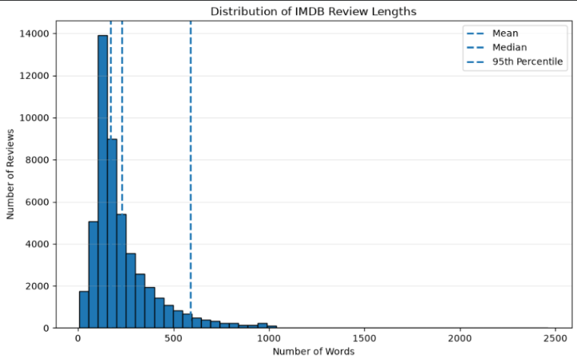

<sub>Figure 1 — Distribution of review lengths. This figure should be generated by the notebook and saved at the path shown.</sub>

</div>

The sequence length should be selected using the actual distribution from the dataset. The recorded value of 600 is a project configuration, not a universal best value for every text dataset.

### 1.6 Target encoding and splitting

The sentiment values are encoded as binary labels. The notebook then creates training and test partitions before fitting the tokenizer.

Recorded partition sizes:

| Partition | Records |
|---|---:|
| Training | 39,665 |
| Test | 9,917 |
| Total after duplicate removal | 49,582 |

The split is designed to preserve an unseen test set for final evaluation. The tokenizer must not learn its vocabulary from the test reviews.

### 1.7 Vocabulary and tokenization

The tokenizer converts each review into a sequence of integer token IDs. The notebook caps the vocabulary at **10,000 tokens** and uses an out-of-vocabulary marker, `<OOV>`, for words not covered by the fitted vocabulary.

Conceptually:

```text
"this movie was excellent"
            |
            v
[token_id, token_id, token_id, token_id]
```

The tokenizer is fitted on training text only. That way, the held-out test set does not influence vocabulary construction.

### 1.8 Sequence padding

Neural networks in the notebook receive sequences with a consistent length. Short sequences are padded; long sequences are truncated.

The recorded configuration uses:

```python
padding="pre"
truncating="pre"
```

Pre-padding inserts zeros at the beginning of shorter sequences. Pre-truncation removes tokens from the beginning of sequences that exceed the maximum length, retaining the later part of the review.

### 1.9 Prepared-data checks

Before training, inspect the resulting array dimensions and confirm that the input and target rows line up.


**Task 1 outcome:** review text is represented as fixed-length token sequences ready for neural-network experiments.

---

# Task 2 — Baseline and RNN Foundations

## Goal

Create a reference classifier and build intuition for the recurrent computation used in later models.

### 2.1 ANN baseline

The baseline architecture uses an embedding representation, flattens the sequence representation, and passes it through dense layers.

```text
Token sequence
      |
   Embedding
      |
    Flatten
      |
 Dense(64, ReLU)
      |
 Dense(1, Sigmoid)
      |
 Sentiment probability
```

The ANN provides a useful comparison point. Because the sequence is flattened, the model does not apply the same recurrent transition at every time step.

### 2.2 Recorded ANN performance


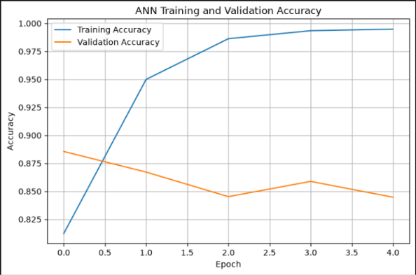

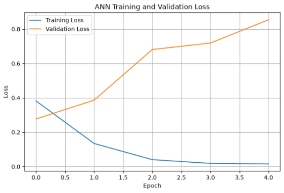

| Metric | Recorded result |
|---|---:|
| Test accuracy | 86.62% |
| Precision | 86.63% |
| Recall | 86.72% |
| F1-score | 86.68% |
| ROC-AUC | 0.9379 |
| Parameters | 1,548,929 |
| Time per epoch | 12.60 s |

These results are included as a baseline for comparison with the recurrent models.

### 2.3 Recurrent-network intuition

A recurrent neural network processes a sequence one step at a time. The current hidden state is calculated from the current input and the previous hidden state.

\[
h_t = \tanh(W_{xh}x_t + W_{hh}h_{t-1} + b)
\]

Here, \(x_t\) is the current input, \(h_{t-1}\) is the previous hidden state, and \(h_t\) is the new hidden state. The recurrent weights are reused at each time step.

### 2.4 Manual NumPy forward pass


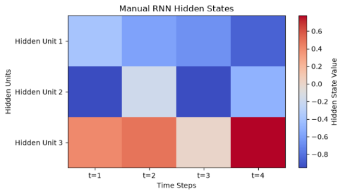

A small RNN is implemented manually to make the calculation easier to follow:

| Setting | Value |
|---|---:|
| Input dimension | 2 |
| Hidden-state dimension | 3 |
| Sequence steps | 4 |

At every step, the current input and previous hidden state are combined, passed through a non-linear activation, and used as the next hidden state.

<div align="center">


<sub>Figure 2 — Hidden-state values across time steps for the small NumPy RNN.</sub>

</div>

### 2.5 Compare manual and Keras calculations

The notebook transfers compatible weights from the NumPy implementation into a Keras `SimpleRNN` and compares the outputs for the same input sequence. This is a practical way to check the manual equations against a framework implementation.

### 2.6 ANN and RNN comparison

| Characteristic | ANN baseline | SimpleRNN |
|---|---|---|
| Sequence handling | Flattened representation | Step-by-step recurrence |
| Shared recurrent transition | No | Yes |
| Carries hidden state across tokens | No recurrent state | Yes |
| Main role in this practical | Baseline | Sequential-model experiment |

**Task 2 outcome:** the baseline score is established, and the hidden-state update that powers recurrent models is demonstrated.

---

# Task 3 — SimpleRNN Experiments

## Goal

Train a recurrent model on the padded reviews and evaluate both predictive quality and training behaviour.

### 3.1 Model layout

The SimpleRNN classifier uses an embedding layer, a recurrent layer, and a sigmoid output.

```text
Token IDs
   |
Embedding (vocabulary 10,000; dimension 32)
   |
SimpleRNN (64 units)
   |
Dense (1 unit, sigmoid)
   |
Positive-class probability
```

### 3.2 Training approach

The notebook compiles the classifier for binary classification and trains it using a validation split. Early stopping is used in the model-training workflow to avoid continuing unnecessarily when validation loss stops improving.

Training curves should be read together: training performance can continue improving even when validation performance stops improving, which may indicate overfitting.

<div align="center">

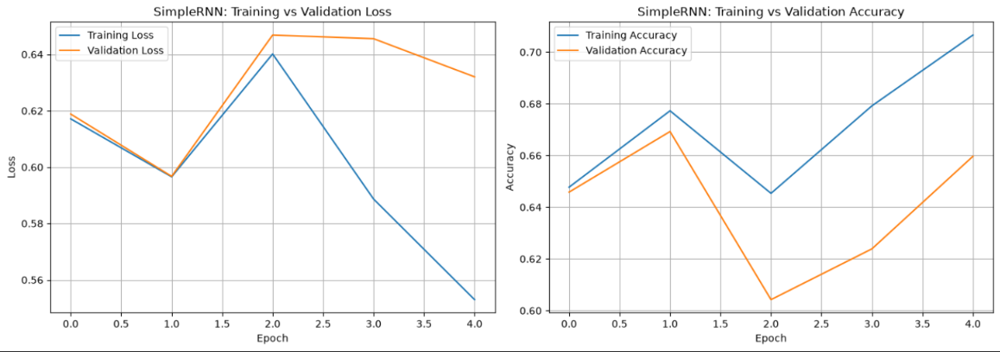

<sub>Figure 3 — SimpleRNN training and validation behaviour.</sub>

</div>

### 3.3 Recorded SimpleRNN results

| Metric | Recorded result |
|---|---:|
| Test accuracy | 79.01% |
| Precision | 88.69% |
| Recall | 66.67% |
| F1-score | 76.12% |
| ROC-AUC | 0.8787 |
| Parameters | 326,273 |
| Epochs recorded | 4 |

The relatively low recall means that the model misses a noticeable share of positive reviews under the selected classification threshold. This is why accuracy should not be the only metric used for model selection.

### 3.4 Confusion matrix

<div align="center">

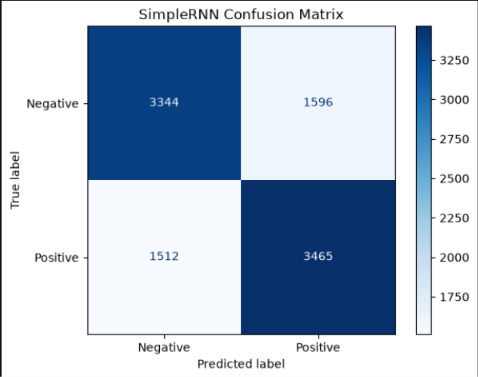

<sub>Figure 4 — Confusion matrix for the SimpleRNN test predictions.</sub>

</div>

A confusion matrix separates correct positive and negative predictions from false positives and false negatives. It makes the types of mistakes easier to interpret than a single accuracy value.

### 3.5 Hidden-state and sequence behaviour


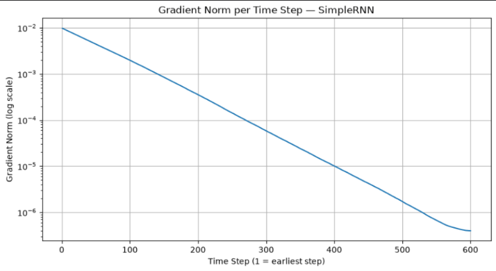

The recurrent state is updated for each token. This provides a mechanism for carrying information forward, but learning dependencies across long sequences can be difficult with a basic recurrent cell.

**Task 3 outcome:** SimpleRNN serves as the first sequence-aware model and establishes a reference for the gated architectures.

---

# Task 4 — Learning Through Time and Gradient Behaviour

## Goal

Understand how the training signal moves through a recurrent sequence and why long dependencies can be difficult to learn.

### 4.1 Backpropagation Through Time

Backpropagation Through Time (BPTT) applies the chain rule through the sequence of recurrent state updates. During training, errors at the output contribute gradients to parameters used across multiple time steps.

As a sequence becomes longer, the gradient calculation passes through more recurrent transitions. Repeated multiplication by derivatives can cause gradients to shrink or grow.

### 4.2 Vanishing gradients

When gradients become very small, early time steps receive a weak learning signal. The model may struggle to learn relationships between words that are far apart in a review.

### 4.3 Exploding gradients

When gradients become excessively large, updates can become unstable. The notebook records gradient behaviour to help illustrate this optimization problem.

<div align="center">


<sub>Figure 5 — Gradient-norm behaviour during the SimpleRNN experiment.</sub>

</div>

### 4.4 Gradient clipping

Gradient clipping limits the magnitude of gradients before the optimizer applies an update. It is a stabilizing technique; it does not guarantee better test performance in every run.

<div align="center">

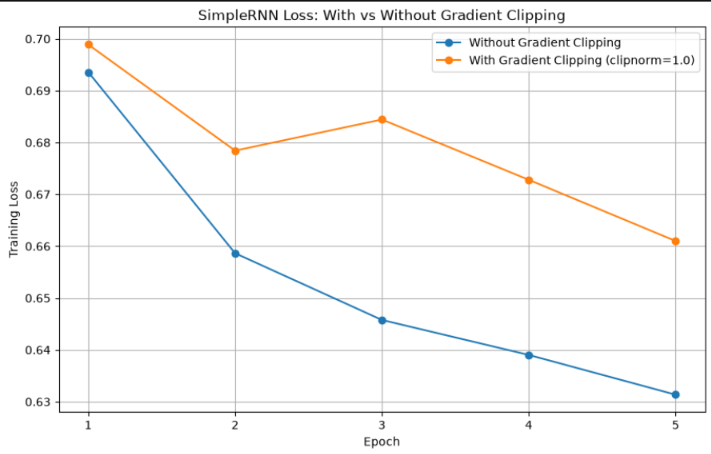

<sub>Figure 6 — Training behaviour with and without gradient clipping.</sub>

</div>

### 4.5 Sequence-length sensitivity


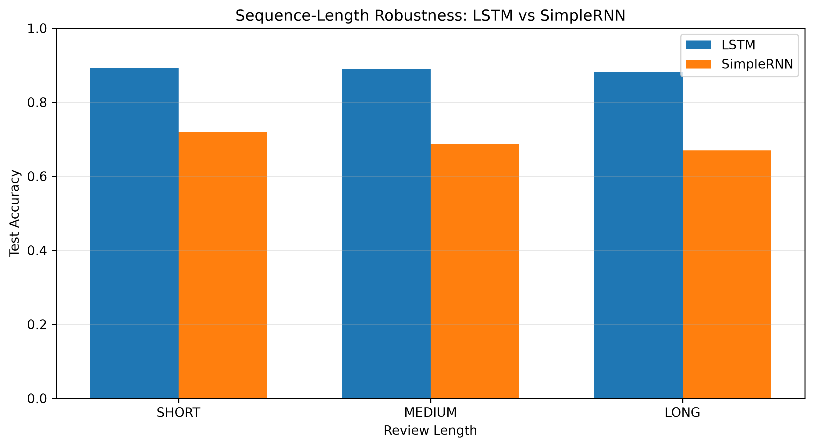

The practical compares model behaviour at different maximum sequence lengths. This helps show the trade-off between retaining more context and increasing computational work.

<div align="center">


<sub>Figure 7 — Accuracy under different sequence-length settings.</sub>

</div>

Recorded sequence-length results:

| Model | Short reviews | Medium reviews | Long reviews |
|---|---:|---:|---:|
| SimpleRNN | 78.83% | 80.20% | 76.67% |
| GRU | 90.17% | 89.98% | 89.05% |

The exact interpretation depends on the notebook's definitions of short, medium, and long review groups. These results indicate that the recorded GRU run was more consistent across those groups than the SimpleRNN run.

### 4.6 GradientTape experiment

The notebook uses TensorFlow's gradient tools to inspect gradients through recurrent computations. The goal is to connect the mathematical explanation of BPTT to quantities measured during model execution.

**Task 4 outcome:** gradient diagnostics explain why gated recurrent cells are worth exploring, while clipping offers one practical tool for training stability.

---

# Task 5 — LSTM Experiments

## Goal

Evaluate a Long Short-Term Memory network, which uses gates and a cell state to regulate information flow through a sequence.

### 5.1 Why use LSTM?

A basic RNN repeatedly updates its hidden state. LSTM adds a cell state and gates that control which information is forgotten, added, and exposed. This design can make learning longer dependencies easier, although it increases computation.

### 5.2 Model layout

```text
Token IDs
   |
Embedding (10,000 words; 32 dimensions)
   |
LSTM (64 units)
   |
Dense (1 unit, sigmoid)
   |
Sentiment prediction
```

### 5.3 Training curves


<div align="center">

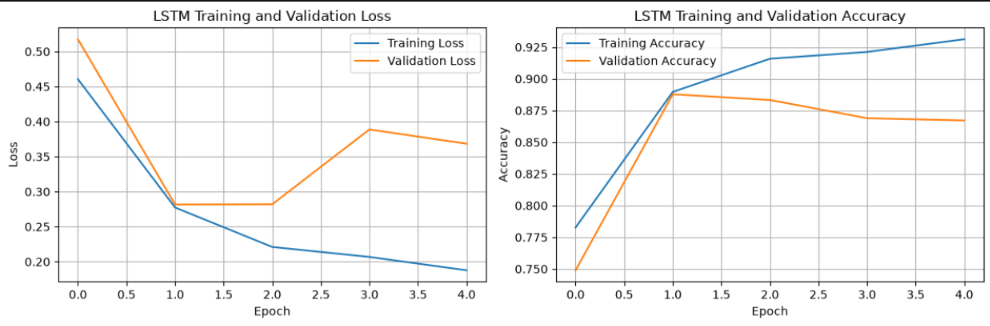

<sub>Figure 8 — LSTM training and validation curves.</sub>

</div>

### 5.4 Confusion matrix

<div align="center">

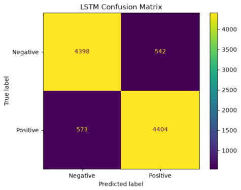

<sub>Figure 9 — LSTM prediction outcomes on the test partition.</sub>

</div>

### 5.5 Gradient comparison with SimpleRNN

<div align="center">

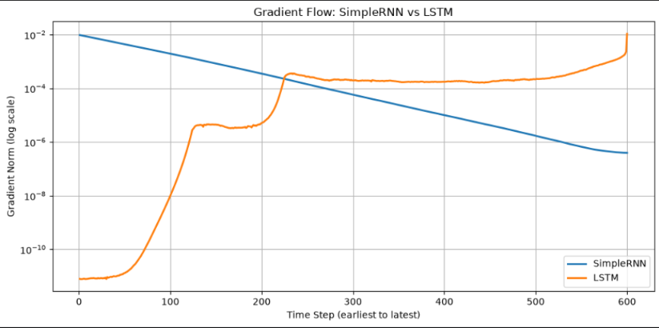

<sub>Figure 10 — Gradient-norm comparison between recurrent architectures.</sub>

</div>

### 5.6 Recorded LSTM results

| Metric | Recorded result |
|---|---:|
| Test accuracy | 88.68% |
| Precision | 87.13% |
| Recall | 90.86% |
| F1-score | 88.95% |
| ROC-AUC | 0.9497 |
| Parameters | 344,897 |
| Epochs recorded | 7 |
| Time per epoch | 179.99 s |

LSTM records the highest recall among the final model rows shown here. This can be important when missing a positive review is more costly than incorrectly marking a negative review as positive.

### 5.7 Stacked LSTM extension


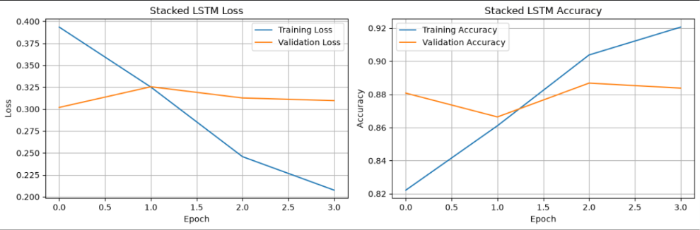

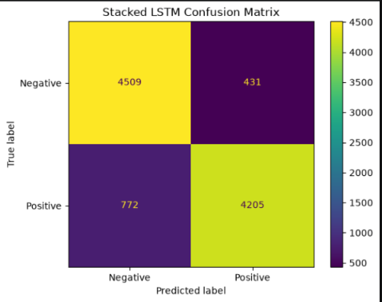

A stacked recurrent model adds another LSTM layer. Additional depth can increase model capacity, but it also increases training cost and does not automatically improve generalization.

Recorded stacked-LSTM results:

| Metric | Recorded result |
|---|---:|
| Test accuracy | 88.31% |
| Precision | 88.58% |
| Recall | 88.07% |
| F1-score | 88.32% |
| ROC-AUC | 0.9499 |
| Parameters | 357,281 |
| Epochs recorded | 6 |
| Time per epoch | 1,358.36 s |

The recorded run does not show a performance improvement over the single-layer LSTM or GRU. Runtime can vary substantially with hardware and implementation details.

**Task 5 outcome:** LSTM improves on the SimpleRNN baseline in the recorded experiment and demonstrates the value of gated memory.

---

# Task 6 — GRU Experiments

## Goal

Train a Gated Recurrent Unit network and compare its balance of predictive quality, parameter count, and training time with LSTM.

### 6.1 GRU idea

GRU uses gates to regulate how information from earlier steps contributes to the current representation. It has a different gate structure from LSTM and does not maintain a separate cell state in the same way.

### 6.2 Model layout

```text
Token IDs
   |
Embedding
   |
GRU (64 units)
   |
Dense (1 unit, sigmoid)
   |
Positive-class probability
```

### 6.3 Training behaviour

<div align="center">

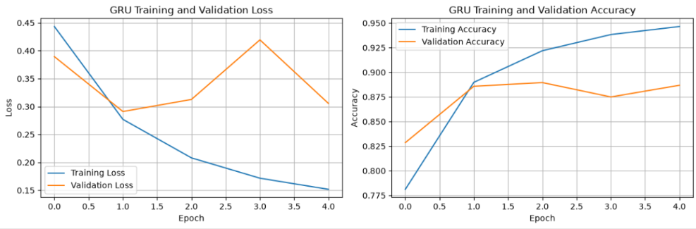

<sub>Figure 11 — GRU training and validation performance.</sub>

</div>

### 6.4 Confusion matrix

<div align="center">

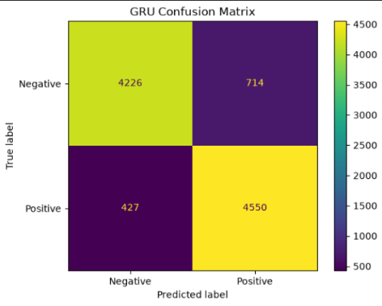

<sub>Figure 12 — GRU classification outcomes on held-out reviews.</sub>

</div>

### 6.5 Gradient comparison across recurrent cells

<div align="center">

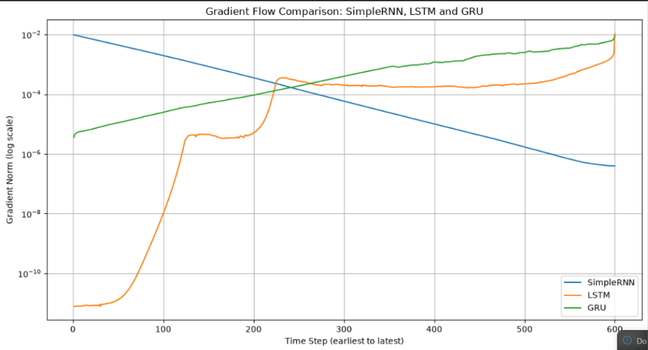

<sub>Figure 13 — Gradient diagnostics across SimpleRNN, LSTM, and GRU experiments.</sub>

</div>

### 6.6 Hidden-unit sensitivity


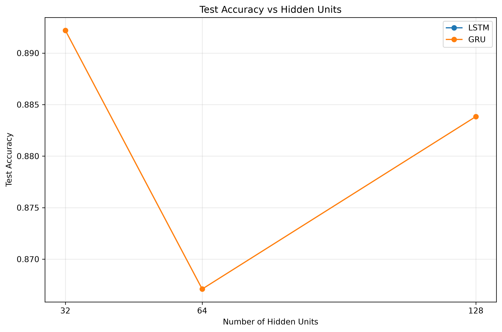

Changing the number of hidden units affects both model capacity and parameter count. The notebook records how the results vary with this setting.

<div align="center">


<sub>Figure 14 — Accuracy across hidden-unit configurations.</sub>

</div>

<div align="center">


<sub>Figure 15 — Model parameter growth as hidden units increase.</sub>

</div>

### 6.7 Recorded GRU results

| Metric | Recorded result |
|---|---:|
| Test accuracy | 89.73% |
| Precision | 89.69% |
| Recall | 89.87% |
| F1-score | 89.78% |
| ROC-AUC | 0.9595 |
| Parameters | 338,881 |
| Epochs recorded | 6 |
| Time per epoch | 174.53 s |

In the recorded comparison, GRU achieves the strongest overall combination of accuracy, F1-score, ROC-AUC, parameter count, and measured epoch time among the gated candidates.

**Task 6 outcome:** GRU becomes the preferred model for the final comparison in this particular run.

---

# Task 7 — Evaluation and Practical Inference

## Goal

Bring the model experiments together, inspect their errors, test new sentences, and state a recommendation based on the recorded evidence.

### 7.1 Compare the model results

The final table uses several metrics because each describes a different aspect of model performance.

- **Accuracy:** proportion of all test examples classified correctly.
- **Precision:** among predicted positives, the proportion that are truly positive.
- **Recall:** among actual positives, the proportion detected by the model.
- **F1-score:** harmonic mean of precision and recall.
- **ROC-AUC:** ranking performance across classification thresholds.
- **Parameter count:** rough indication of model size, not a direct measure of inference speed.

### 7.2 Combined model comparison

| Model | Accuracy | Precision | Recall | F1-score | ROC-AUC | Parameters |
|---|---:|---:|---:|---:|---:|---:|
| ANN | 86.62% | 86.63% | 86.72% | 86.68% | 0.9379 | 1,548,929 |
| SimpleRNN | 79.01% | 88.69% | 66.67% | 76.12% | 0.8787 | 326,273 |
| LSTM | 88.68% | 87.13% | 90.86% | 88.95% | 0.9497 | 344,897 |
| Stacked LSTM | 88.31% | 88.58% | 88.07% | 88.32% | 0.9499 | 357,281 |
| GRU | **89.73%** | **89.69%** | 89.87% | **89.78%** | **0.9595** | **338,881** |

<div align="center">


<sub>Figure 16 — Final metrics visualized from the notebook comparison.</sub>

</div>

### 7.3 ROC curve comparison


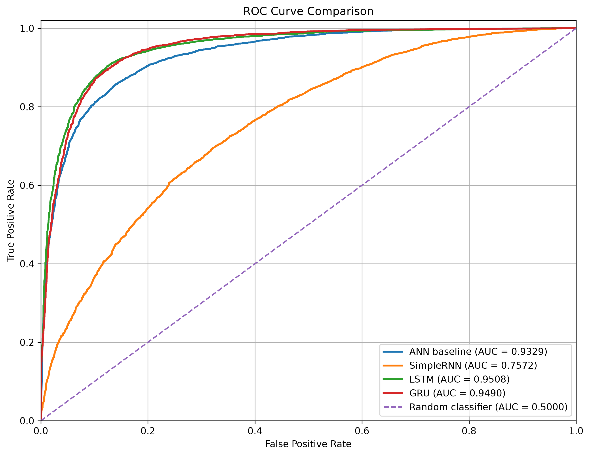

ROC curves show how the true-positive rate changes against the false-positive rate as the classification threshold varies.

<div align="center">


<sub>Figure 17 — ROC curve comparison for the evaluated models.</sub>

</div>

The GRU's recorded ROC-AUC of 0.9595 is the highest in the table. ROC-AUC complements threshold-specific measures; it does not replace checking precision and recall at the threshold used by the application.

### 7.4 Review-length robustness

The notebook groups reviews by length to test whether the model performs similarly on shorter and longer text.

<div align="center">


<sub>Figure 18 — Accuracy grouped by review length.</sub>

</div>

The recorded GRU accuracies are 90.17% for short reviews, 89.98% for medium reviews, and 89.05% for long reviews. The SimpleRNN values are 78.83%, 80.20%, and 76.67%, respectively.

### 7.5 Error inspection


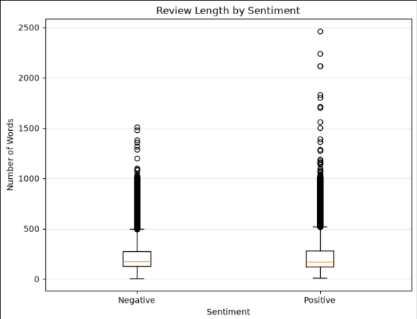

The error-analysis step examines false positives and false negatives rather than treating all incorrect predictions as interchangeable.

In the recorded GRU analysis:

| Error category | Count |
|---|---:|
| False positives | 514 |
| False negatives | 504 |

A false positive is a negative review predicted as positive. A false negative is a positive review predicted as negative. The notebook prints example reviews with their true labels, predicted labels, and predicted positive probabilities.

Recorded example probabilities:

| Example | Positive-class probability |
|---|---:|
| False positive 1 | 0.6195 |
| False positive 2 | 0.7703 |
| False positive 3 | 0.7146 |
| False positive 4 | 0.6687 |
| False negative 1 | 0.3560 |
| False negative 2 | 0.1355 |
| False negative 3 | 0.0753 |
| False negative 4 | 0.4830 |

Potential reasons for mistakes include mixed opinions, sarcasm, negation, sentiment changes within a long review, and ambiguous wording. These are plausible interpretations of text-classification errors, not proof of the cause of every individual error.

### 7.6 Custom text predictions


The notebook defines a reusable prediction function that follows the same preprocessing steps as training:

```text
New sentence
     |
Text cleaning
     |
Training tokenizer
     |
Token sequence
     |
Padding to the selected length
     |
Selected model prediction
     |
Probability and class label
```

Example usage:

```python
predict_sentiment(
    "This movie was absolutely wonderful and I loved it."
)
```

The recorded example output is:

```python
{
    "label": "Positive",
    "positive_probability": 0.9850381016731262
}
```

The six custom language tests recorded in the notebook are summarized below.

| Test case | Predicted label | Positive probability |
|---|---|---:|
| Clearly positive | Positive | 0.9787 |
| Clearly negative | Negative | 0.0053 |
| Negation | Negative | 0.1630 |
| Double negation | Negative | 0.2545 |
| Sarcastic example | Negative | 0.4140 |
| Very short positive text | Positive | 0.9589 |

These are examples from the recorded run, not guarantees about how the model will respond to every sentence of the same type. In particular, double negation and sarcasm are difficult linguistic patterns, and the table illustrates that the model can still misinterpret them.

### 7.7 Final model recommendation

The recorded results support choosing **GRU** as the overall model for this practical.

| Decision factor | Preferred result in the recorded run |
|---|---|
| Highest accuracy | GRU — 89.73% |
| Highest precision | GRU — 89.69% |
| Highest recall | LSTM — 90.86% |
| Highest F1-score | GRU — 89.78% |
| Highest ROC-AUC | GRU — 0.9595 |
| Lowest parameter count among recurrent models listed | SimpleRNN — 326,273 |
| Best balance among gated candidates | GRU |

The recommendation depends on the evaluation priorities. If recall is the dominant requirement, LSTM deserves consideration because it records the highest recall. For the overall combination of metrics in this run, GRU is the preferred candidate.

---

## Results at a Glance

| Architecture | Accuracy | Main observation |
|---|---:|---|
| ANN | 86.62% | Useful baseline, relatively high parameter count |
| SimpleRNN | 79.01% | Lowest accuracy and recall in the comparison |
| LSTM | 88.68% | Strong recall |
| Stacked LSTM | 88.31% | More computation without the best final score |
| GRU | **89.73%** | Best overall balance in this recorded run |

<div align="center">


<sub>Figure 19 — Combined training curves for the recurrent models.</sub>

</div>
---


## Repository Layout

Keep the README, notebook, requirements file, and screenshots in a predictable structure:

```text
movie-review-sentiment/
├── README.md
├── requirements.txt
├── IMDB_Sentiment_Analysis.ipynb
├── IMDB_Sentiment_Analysis.html
├── model_comparison_results.csv
├── data/
│   └── IMDB Dataset.csv
└── plot/
    ├── accuracy_vs_hidden_units.png
    ├── ANN_Training&Validation_accuracy.png
    ├── ANN_Training&Validation_loss.png
    ├── Distribution_imbd_review.png
    ├── Gradient_flow_simpleRNN_vs_LSTM_VS_GRU.png
    ├── Gradint_simplernn_vs_lstm.png
    ├── GRU_confusion_matrix.png
    ├── GRU_loss_vs_accuracy.png
    ├── LSTM_confusion_matrix.png
    ├── LSTM_hidden_states_gradint_loss.png
    ├── LSTM_loss_vs_accuracy.png
    ├── RNN_hidden_states.png
    ├── roc_curve_comparison.png
    ├── sentiment_review.png
    ├── sequence_length_robustness.png
    ├── SimpleRNN_confusion_matrix.png
    ├── SimpleRNN_gradient_norm.png
    ├── SimpleRNN_loss_&_Accuracy.png
    ├── SimpleRNN_loss_with_vs_without_gradient.png
    ├── Stacked_LSTM_confusion_matrix.png
    └── Stacked_LSTM_loss_vs_accuracy.png
```

The README references the screenshot folder as `plot/` (singular), as requested. Make sure your local directory and image filenames match this layout. If your CSV is stored in the project root instead of `data/`, either keep it there or update the notebook's data path before moving it.


## Example `requirements.txt`

The following is a starting list of direct dependencies used by the project. For a reproducible submission, record the versions that work in your environment.

```text
tensorflow
scikit-learn
pandas
numpy
matplotlib
seaborn
jupyter
```


## Observations

### 1. A baseline is useful

The ANN establishes a reference score before recurrent layers are introduced. It also demonstrates that a strong baseline is valuable when judging whether a more complex model is worth its added cost.

### 2. Sequential structure matters

Recurrent layers update a hidden state across the tokens in a review. That structure is a natural fit for experiments involving word order and contextual dependencies.

### 3. SimpleRNN has limitations on this task

The recorded SimpleRNN model has lower accuracy and recall than the gated alternatives. Its results make the gradient-flow experiments relevant to the overall project.

### 4. Gated architectures improve the recorded results

Both LSTM and GRU outperform SimpleRNN in the recorded metrics. The gates provide additional control over the information carried through the sequence.

### 5. Extra layers cost time

The recorded Stacked LSTM run takes considerably longer per epoch than the other models shown. Additional layers should be justified by measurable benefits, not by complexity alone.

### 6. Metrics answer different questions

Accuracy alone can hide a model's weakness on a particular class. Precision, recall, F1-score, ROC-AUC, confusion matrices, and error examples help build a more complete picture.

### 7. Custom sentences are a useful sanity check

A handful of hand-written examples can expose behaviour that aggregate metrics do not reveal. However, these examples are not a substitute for a separate, representative evaluation dataset.


# 🏁 Final Conclusion

This project builds sentiment analysis from the fundamentals of text preprocessing through increasingly capable recurrent architectures.

The notebook first prepares IMDB reviews using duplicate removal, text cleaning, train/test splitting, tokenization and padding. It then establishes an ANN baseline and manually demonstrates the hidden-state mathematics of SimpleRNN.

The BPTT experiments explore the optimization difficulties of recurrent networks, including vanishing and exploding gradients. LSTM introduces a gated cell-state mechanism, while GRU provides a simpler gated alternative.

---

<div align="center">

# 👨‍💻 Author

## Santosh Verma

### Data Analyst · AI/ML Developer

### Project notes

**Tools:** Python · TensorFlow/Keras · Pandas · NumPy · Scikit-learn · Matplotlib · Seaborn · Jupyter

**Before publishing:** verify all figures, notebook outputs, metric values, and dataset paths against the final version of your own project.

</div>
